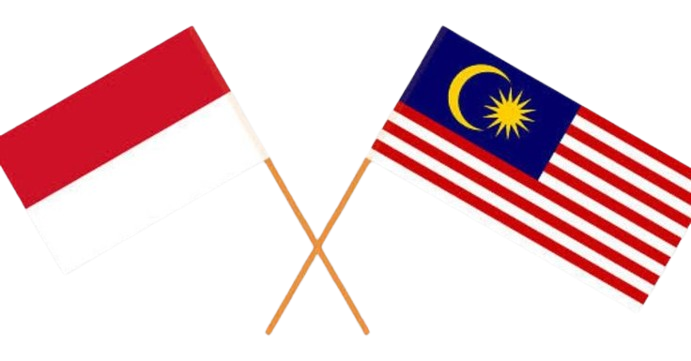

  

 𝐃𝐍𝐈

ᴄᴜᴘᴄᴀᴋᴇ-ʙᴜɢ / ᴊɪɴɴ

—𝑰𝒇 𝒚𝒐𝒖 𝒅𝒐𝒏'𝒕 𝒌𝒏𝒐𝒘 𝒂𝒃𝒐𝒖𝒕 𝒉𝒊𝒎, 𝒕𝒉𝒆𝒏 𝑰'𝒍𝒍 𝒕𝒆𝒍𝒍 𝒚𝒐𝒖

𝑰 𝒓𝒆𝒂𝒍𝒍𝒚 𝒘𝒂𝒏𝒕𝒆𝒅 𝒕𝒐 𝒔𝒉𝒂𝒓𝒆 𝒕𝒉𝒊𝒔 𝒃𝒆𝒄𝒂𝒖𝒔𝒆 𝑰'𝒎 𝒈𝒆𝒏𝒖𝒊𝒏𝒆𝒍𝒚 𝒖𝒑𝒔𝒆𝒕 ,,

- 𝑾𝒉𝒆𝒏 𝒉𝒆 𝒋𝒐𝒊𝒏𝒆𝒅 𝒎𝒚 𝒈𝒓𝒐𝒖𝒑, 𝑱𝒂𝒛, 𝑻𝒖𝒏𝒂, 𝒂𝒏𝒅 𝑰 𝒘𝒆𝒍𝒄𝒐𝒎𝒆𝒅 𝒉𝒊𝒎 𝒑𝒐𝒍𝒊𝒕𝒆𝒍𝒚 𝒂𝒏𝒅 𝒌𝒊𝒏𝒅𝒍𝒚. 𝑾𝒆 𝒂𝒍𝒘𝒂𝒚𝒔 𝒑𝒍𝒂𝒚𝒆𝒅 𝒕𝒐𝒈𝒆𝒕𝒉𝒆𝒓, 𝒂𝒏𝒅 𝒘𝒆 𝒂𝒍𝒔𝒐 𝒉𝒆𝒍𝒑𝒆𝒅 𝑱𝒊𝒏𝒏 𝒂 𝒍𝒐𝒕 𝒊𝒏 𝒆𝒗𝒆𝒓𝒚 𝒅𝒊𝒇𝒇𝒊𝒄𝒖𝒍𝒕𝒚, 𝒃𝒖𝒕...

..𝑱𝒊𝒏𝒏 𝒔𝒕𝒂𝒓𝒕𝒆𝒅 𝒂𝒄𝒕𝒊𝒏𝒈 𝒔𝒕𝒓𝒂𝒏𝒈𝒆𝒍𝒚.. 𝒉𝒆 𝒘𝒐𝒖𝒍𝒅 𝒐𝒇𝒕𝒆𝒏 𝒃𝒆 𝒓𝒖𝒅𝒆 𝒕𝒐 𝒖𝒔 𝒇𝒐𝒓 𝒏𝒐 𝒓𝒆𝒂𝒔𝒐𝒏, 𝒆𝒔𝒑𝒆𝒄𝒊𝒂𝒍𝒍𝒚 𝒕𝒐 𝑱𝒂𝒛. 𝑯𝒆 𝒔𝒂𝒊𝒅 𝒊𝒕 𝒘𝒂𝒔 𝒃𝒆𝒄𝒂𝒖𝒔𝒆 𝒐𝒇 𝒉𝒊𝒔 𝒒𝒖𝒊𝒄𝒌 𝒕𝒆𝒎𝒑𝒆𝒓 𝒂𝒏𝒅 𝒏𝒆𝒗𝒆𝒓 𝒂𝒑𝒐𝒍𝒐𝒈𝒊𝒛𝒆𝒅 𝒕𝒐 𝑱𝒂𝒛. 𝑰 𝒂𝒍𝒘𝒂𝒚𝒔 𝒇𝒐𝒓𝒈𝒂𝒗𝒆 𝑱𝒊𝒏𝒏, 𝒃𝒖𝒕 𝒕𝒉𝒆 𝒎𝒐𝒓𝒆 𝑰 𝒅𝒊𝒅, 𝒕𝒉𝒆 𝒎𝒐𝒓𝒆 𝒉𝒆 𝒅𝒊𝒔𝒕𝒐𝒓𝒕𝒆𝒅 𝒕𝒉𝒆 𝒉𝒆𝒍𝒑 𝒘𝒆 𝒉𝒂𝒅 𝒈𝒊𝒗𝒆𝒏 𝒉𝒊𝒎.

- 𝑻𝒊𝒍𝒍, 𝑻𝒊𝒍𝒍 𝒄𝒐𝒖𝒍𝒅𝒏'𝒕 𝒔𝒕𝒂𝒏𝒅 𝑱𝒊𝒏𝒏'𝒔 𝒃𝒆𝒉𝒂𝒗𝒊𝒐𝒓 𝒂𝒏𝒅 𝒂𝒕𝒕𝒊𝒕𝒖𝒅𝒆, 𝒔𝒐 𝒉𝒆 𝒅𝒊𝒅𝒏'𝒕 𝒘𝒂𝒏𝒕 𝒕𝒐 𝒊𝒏𝒕𝒆𝒓𝒂𝒄𝒕 𝒘𝒊𝒕𝒉 𝑱𝒊𝒏𝒏 𝒎𝒖𝒄𝒉.

𝑰𝒕 𝒘𝒂𝒔 𝒐𝒏𝒍𝒚 𝒂𝒕 𝒕𝒉𝒊𝒔 𝒑𝒐𝒊𝒏𝒕 𝒕𝒉𝒂𝒕 𝑰 𝒕𝒓𝒖𝒍𝒚 𝒉𝒂𝒕𝒆𝒅 𝒉𝒊𝒎:

1. 𝑯𝒆 𝒔𝒑𝒐𝒌𝒆 𝒊𝒍𝒍 𝒐𝒇 𝒎𝒚 𝒈𝒓𝒐𝒖𝒑, 𝒄𝒂𝒍𝒍𝒊𝒏𝒈 𝒖𝒔 𝒖𝒏𝒄𝒊𝒗𝒊𝒍𝒊𝒛𝒆𝒅 𝒂𝒏𝒅 𝒊𝒏𝒅𝒊𝒇𝒇𝒆𝒓𝒆𝒏𝒕 𝒕𝒐 𝒉𝒊𝒎, 𝑾𝑨𝑰𝑻 𝑾𝑯𝑨𝑻..!!??

2. 𝑯𝒆 𝒆𝒗𝒆𝒏 𝒄𝒂𝒍𝒍𝒆𝒅 𝑱𝒂𝒛 𝒂 𝒏𝒖𝒊𝒔𝒂𝒏𝒄𝒆 𝒋𝒖𝒔𝒕 𝒃𝒆𝒄𝒂𝒖𝒔𝒆 𝑱𝒂𝒛 𝒘𝒂𝒔 𝒈𝒊𝒗𝒊𝒏𝒈 𝒂𝒅𝒗𝒊𝒄𝒆 𝒂𝒃𝒐𝒖𝒕 𝑱𝒊𝒏𝒏'𝒔 𝒂𝒕𝒕𝒊𝒕𝒖𝒅𝒆.

3. 𝑱𝒊𝒏𝒏 𝒌𝒆𝒑𝒕 𝒔𝒆𝒏𝒅𝒊𝒏𝒈 𝒔𝒕𝒓𝒂𝒏𝒈𝒆 𝒂𝒏𝒅 𝒅𝒊𝒔𝒈𝒖𝒔𝒕𝒊𝒏𝒈 𝒗𝒊𝒅𝒆𝒐𝒔 𝒕𝒉𝒂𝒕 𝒎𝒂𝒅𝒆 𝒎𝒆 𝒂𝒏𝒅 𝒎𝒚 𝒈𝒓𝒐𝒖𝒑 𝒗𝒆𝒓𝒚 𝒖𝒏𝒄𝒐𝒎𝒇𝒐𝒓𝒕𝒂𝒃𝒍𝒆; 𝒘𝒆 𝒄𝒐𝒖𝒍𝒅𝒏'𝒕 𝒔𝒂𝒚 𝒂𝒏𝒚𝒕𝒉𝒊𝒏𝒈 𝒕𝒐 𝒉𝒊𝒎 𝒂𝒏𝒚𝒎𝒐𝒓𝒆.

4. 𝑱𝒊𝒏𝒏 𝒂𝒍𝒘𝒂𝒚𝒔 𝒃𝒍𝒂𝒎𝒆𝒔 𝒆𝒗𝒆𝒓𝒚𝒐𝒏𝒆, 𝒆𝒔𝒑𝒆𝒄𝒊𝒂𝒍𝒍𝒚 𝑻𝒖𝒏𝒂 𝒂𝒏𝒅 𝑱𝒂𝒛, 𝒂𝒏𝒅 𝒂𝒍𝒘𝒂𝒚𝒔 𝒎𝒂𝒌𝒆𝒔 𝒖𝒑 𝒖𝒏𝒃𝒆𝒍𝒊𝒆𝒗𝒂𝒃𝒍𝒆 𝒔𝒕𝒐𝒓𝒊𝒆𝒔. 𝑻𝒉𝒊𝒔 𝒊𝒔 𝒔𝒐𝒎𝒆𝒕𝒉𝒊𝒏𝒈 𝒘𝒆 𝒄𝒂𝒏'𝒕 𝒕𝒐𝒍𝒆𝒓𝒂𝒕𝒆 𝒇𝒐𝒓 𝒍𝒐𝒏𝒈.

"𝑰𝒕 𝒎𝒖𝒔𝒕 𝒃𝒆 𝒃𝒆𝒄𝒂𝒖𝒔𝒆 𝒘𝒆'𝒓𝒆 𝒕𝒐𝒐 𝒔𝒐𝒇𝒕-𝒉𝒆𝒂𝒓𝒕𝒆𝒅 𝒕𝒐𝒘𝒂𝒓𝒅𝒔 𝒂 𝒑𝒆𝒓𝒔𝒐𝒏 𝒍𝒊𝒌𝒆 𝒕𝒉𝒊𝒔. 𝑾𝒆 𝒂𝒍𝒘𝒂𝒚𝒔 𝒐𝒗𝒆𝒓𝒍𝒐𝒐𝒌 𝒂𝒏𝒅 𝒇𝒐𝒓𝒈𝒊𝒗𝒆 𝑱𝒊𝒏𝒏'𝒔 𝒎𝒊𝒔𝒕𝒂𝒌𝒆𝒔, 𝒚𝒆𝒕 𝒕𝒉𝒆 𝒓𝒆𝒔𝒖𝒍𝒕 𝒘𝒆 𝒈𝒆𝒕 𝒇𝒓𝒐𝒎 𝒉𝒊𝒎 𝒊𝒔 𝒎𝒐𝒄𝒌𝒆𝒓𝒚, 𝒓𝒖𝒅𝒆𝒏𝒆𝒔𝒔, 𝒂𝒓𝒓𝒐𝒈𝒂𝒏𝒄𝒆, 𝒂𝒏𝒅 𝒂 𝒍𝒂𝒄𝒌 𝒐𝒇 𝒔𝒆𝒍𝒇-𝒓𝒆𝒔𝒑𝒆𝒄𝒕. 𝑰 𝒇𝒆𝒆𝒍 𝒔𝒐𝒓𝒓𝒚 𝒇𝒐𝒓 𝒕𝒉𝒐𝒔𝒆 𝒘𝒉𝒐 𝒌𝒏𝒐𝒘 𝑱𝒊𝒏𝒏 𝒂𝒏𝒅 𝒅𝒐𝒏'𝒕 𝒌𝒏𝒐𝒘 𝒉𝒊𝒔 𝒕𝒓𝒖𝒆 𝒏𝒂𝒕𝒖𝒓𝒆!.."

